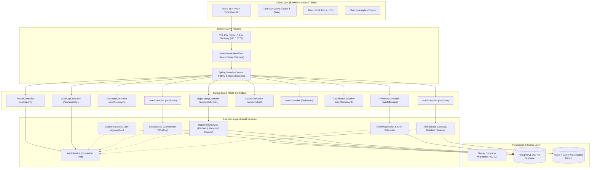
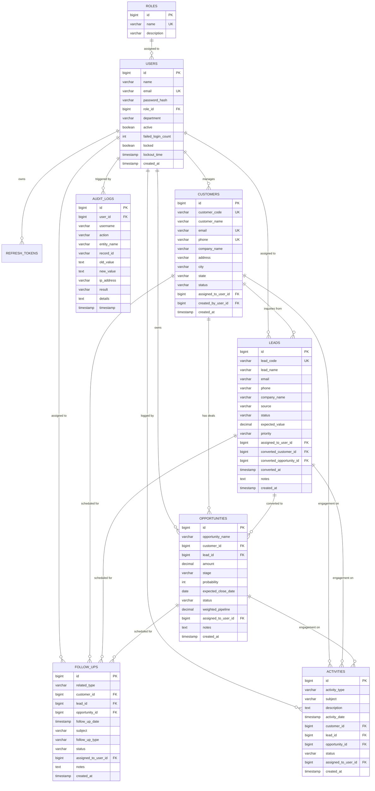

# ACXIOMCRM — Enterprise Customer Relationship & Sales Management Platform

[](https://adoptium.net)
[](https://spring.io/projects/spring-boot)
[](https://react.dev)
[](https://www.typescriptlang.org)
[](https://tailwindcss.com)
[](https://vitejs.dev)
[]()

**AcxiomCRM** is a production-grade, enterprise-scale Customer Relationship Management (CRM) and Sales Pipeline Management system engineered to modern SaaS standards. It strictly preserves and implements all business rules, validation workflows, multi-tier user role scopes, audit tracking, and reporting specifications from the AcxiomCRM master specification.

---

## 1. Executive Architecture & Technology Stack

The platform is designed with a decoupled, high-performance architecture:
- **Backend**: Java 17, Spring Boot 3.2.5, Spring Security, Spring Data JPA, Hibernate, JWT (short-lived access + rotated refresh tokens with reuse detection), BCrypt, Spring Validation, Flyway migrations, and OpenAPI 3.0 documentation.
- **Frontend**: React 18 with TypeScript, Vite, Tailwind CSS, Lucide React icons, TanStack Query, React Hook Form with Zod schema validation, and Chart.js data visualizations.
- **Persistence & Infrastructure**: PostgreSQL 16 (production), H2 in-memory (dev/test), Redis 7 (caching/sessions), Docker Compose containerization.

### Exact Brand Color Palette

AcxiomCRM adheres strictly to the corporate brand visual guidelines:
- **Primary Deep Teal**: `#097C87` (Primary branding, sidebar, main CTA buttons)
- **Bright Cyan**: `#23CED9` (Active navigation states, badges, charts, accents)
- **Warm Peach**: `#FCA47C` (Pipeline highlights, high-priority badges, alert states)
- **Soft Yellow**: `#F9D779` (In-progress warnings, qualification stage indicators)
- **Sage Green**: `#A1CCA6` (Success states, won deals, active badges, KPI trends)

---

## 2. System Architecture Diagram



---

## 3. Database Entity-Relationship (ER) Diagram



---

## 4. Default Seed Credentials (Evaluation Accounts)

All accounts are pre-seeded via Flyway migrations and `DataInitializer` with strong BCrypt hashes:

| Role | Email Address | Default Password | Access Scope |
| :--- | :--- | :--- | :--- |
| **Admin** | `admin@acxiomcrm.com` | `Admin@Acxiom2026!` | Global access, user administration, security unlocks, full audit logs |
| **Manager** | `manager@acxiomcrm.com` | `Manager@Acxiom2026!` | Team-scoped access, lead reassignments, sales pipeline, management reports |
| **Sales Executive 1** | `sales1@acxiomcrm.com` | `Sales@Acxiom2026!` | Personal assigned leads, customers, opportunities, and follow-ups |
| **Sales Executive 2** | `sales2@acxiomcrm.com` | `Sales@Acxiom2026!` | Personal assigned leads, customers, opportunities, and follow-ups |

*Quick login buttons are available on the `/login` screen to effortlessly switch between roles during review.*

---

## 5. Security & Business Rules Implementation

1. **Authentication & Authorization**:
   - Access tokens are kept exclusively in memory on the frontend; never written to `localStorage`.
   - Refresh token rotation issues a new refresh token on every `/api/auth/refresh` invocation and detects reuse attacks.
   - Account lockout automatically locks out any user after **5 consecutive failed attempts** for **15 minutes**.
   - Admins can immediately unlock users through the User Management console (`POST /api/users/{id}/unlock`).

2. **Customer Management**:
   - Unique customer codes are generated automatically (e.g. `CUST-1001`).
   - Duplicate prevention on both email and phone numbers.
   - **360° Profile Viewer**: Aggregates customer master data, related leads, revenue opportunities, scheduled follow-ups, touchpoint activities, and chronological audit trail.

3. **Lead Sourcing & Mandatory Conversion**:
   - Tracks source (`WEBSITE`, `REFERRAL`, `COLD_CALL`, `CAMPAIGN`, `PARTNER`) and status progression.
   - **Lead Conversion Workflow (`POST /api/leads/{id}/convert`)**: Automatically promotes a qualified lead to an active Customer record, provisions a new Sales Opportunity in the `QUALIFICATION` stage, links all foreign keys, updates lead status to `CONVERTED`, and writes immutable audit entries.

4. **Sales Opportunity & Interactive Kanban Pipeline**:
   - Multi-stage progression: `QUALIFICATION` &rarr; `PROPOSAL` &rarr; `NEGOTIATION` &rarr; `WON` &rarr; `LOST`.
   - Business validation: deal amount must be > 0, probability between 0–100%, expected close date today or in future.
   - Interactive Kanban board calculates column totals and updates backend pipeline stages via `PATCH /api/opportunities/{id}/stage`.
   - Weighted pipeline formula: `amount * (probability / 100)`.

5. **Follow-Up & SLA Management**:
   - Validates that scheduled follow-up dates cannot be in the past.
   - Dedicated completion workflow (`PATCH /api/followups/{id}/complete`) prompts for client meeting outcome notes.
   - Automatic overdue SLA tracking with warning banners and 15-minute background scanning scheduler.

6. **Audit Trail & Reports**:
   - Immutable audit logging for every create, update, delete, stage change, and authentication event.
   - Visual inspection modal compares previous state (`oldValue`) vs updated state (`newValue`) JSON diffs.
   - Tabular reports with date range filtering and client-side CSV extract downloads.

7. **Password Recovery & Reset Workflow**:
   - Cryptographically secure SHA-256 token-based password reset workflow (`POST /api/auth/forgot-password` and `POST /api/auth/reset-password`).
   - Single-use tokens with 1-hour expiration; all active refresh tokens invalidated upon password change.
   - Strict password complexity enforced (min 8 chars, uppercase, lowercase, number, special character).
   - In dev mode, simulation link logged directly to backend console for rapid testing.

8. **Rate Limiting & Admin Account Protection**:
   - In-memory sliding-window token bucket filter protecting sensitive endpoints (`/api/auth/login`, `/api/auth/forgot-password`, `/api/auth/reset-password`, `/api/auth/refresh`).
   - Exceeded limits return `HTTP 429 Too Many Requests` with RFC-compliant `Retry-After` header.
   - Guard against administrative lockout: platform strictly blocks deactivating or demoting the only active system administrator.

9. **Frontend Code-Splitting & Route-Level Lazy Loading**:
   - All feature pages code-split via `React.lazy()` with `Suspense` and animated skeleton fallbacks.
   - Initial JavaScript bundle reduced from 756 kB to 330 kB for instant page load speed.

---

## 6. Quick Start & Setup Instructions

### Option A: Running with Docker Compose (Full Stack)

Ensure Docker Desktop is running:

```bash
# Clone the repository
git clone https://github.com/acxiom/acxiom-crm.git
cd Acxiomcrm

# Start all services (PostgreSQL 16, Redis 7, Spring Boot Backend, React Vite Frontend)
docker-compose up --build -d

# Check service status
docker-compose ps
```

Services will be accessible at:
- **Frontend Application**: `http://localhost:5173`
- **Backend API**: `http://localhost:8085/api` (or `:8080` in Docker)
- **Swagger / OpenAPI Documentation**: `http://localhost:8085/swagger-ui/index.html`
- **PostgreSQL**: `localhost:5432` (db: `acxiomcrm`, user: `acxiom_user`, pass: `AcxiomSecure2026!`)
- **Redis**: `localhost:6379`

---

### Option B: Running Locally (Development Mode)

#### 1. Backend (Java 17 & Maven)
The backend uses an embedded PostgreSQL-compatible H2 in-memory database with automatic Flyway schema migration (V1, V2, V3) for instant local development without installing Postgres:

```bash
# From project root
tools\maven\bin\mvn.cmd spring-boot:run -f backend/pom.xml
# Backend will start on http://localhost:8085 (with Swagger UI at http://localhost:8085/swagger-ui/index.html)
```

#### 2. Frontend (Node.js & Vite)

```bash
# From project root
npm.cmd --prefix frontend run dev
# Frontend will start on http://localhost:5173
```

---

## 7. Testing Suite

### Run Backend Unit & Integration Tests (JUnit 5 + Mockito + Testcontainers)

```bash
tools\maven\bin\mvn.cmd test -f backend/pom.xml
```
*All tests pass with 0 failures, verifying authentication, account lockouts, refresh rotation, and opportunity business validation.*

### Run Frontend Typecheck & Build Verification

```bash
npm --prefix frontend run build
```
*Builds production assets to `frontend/dist` with 0 TypeScript or linting errors.*

---

## 8. REST API Reference (OpenAPI 3.0)

Interactive API documentation and schema explorers are hosted live at `http://localhost:8080/swagger-ui.html`.

Key endpoints include:
- `POST /api/auth/login` — Authenticate and receive JWT access token
- `POST /api/auth/refresh` — Rotate refresh token
- `POST /api/auth/logout` — Revoke token session
- `GET /api/dashboard?period={TODAY|THIS_WEEK|THIS_MONTH|ALL}` — Role-scoped executive KPIs and charts
- `GET /api/customers` — Paged customer search & filtering
- `GET /api/customers/{id}/360` — Complete 360-degree customer profile
- `POST /api/leads/{id}/convert` — Convert lead into Customer + Opportunity
- `GET /api/opportunities/pipeline-summary` — Pipeline totals and stage breakdown
- `PATCH /api/opportunities/{id}/stage` — Advance deal stage on Kanban board
- `PATCH /api/followups/{id}/complete` — Complete follow-up with outcome notes
- `POST /api/users/{id}/unlock` — Admin unlock for locked-out accounts
- `GET /api/reports/{pipeline|leads|customers|conversions|followups}` — Analytic extract endpoints
- `GET /api/audit-logs` — Full compliance audit trail

